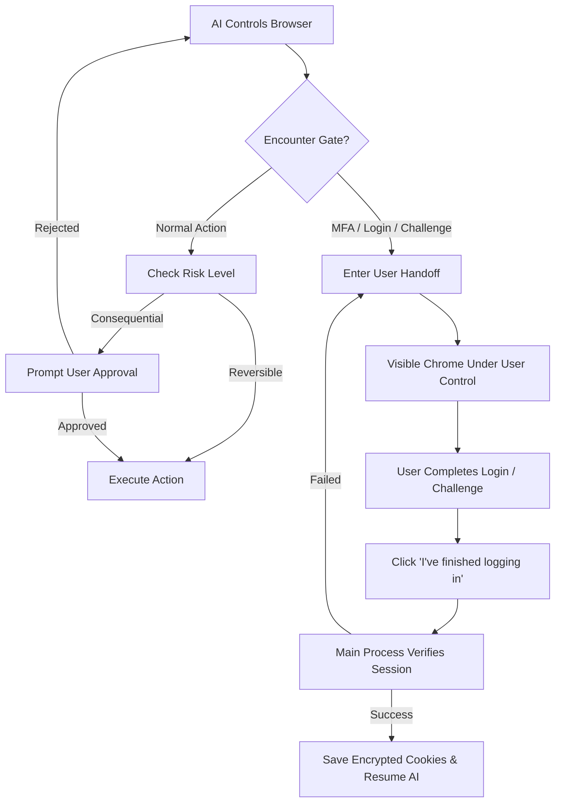

# Browser Use

aiFetchly includes a built-in **Browser Use** capability that lets the AI assistant launch and operate a visible, Puppeteer-controlled Google Chrome browser. You can watch the assistant navigate websites, research information, and automate multi-step workflows, or take manual control whenever you need to.


Browser Use is built around visibility, privacy, and safety: you can inspect every action before or while it executes, keep full control over your authenticated accounts, and intervene at any time.

---

## Key Highlights

- **Visible Headed Chrome**: Runs a real Chrome browser window on your desktop so you can see exactly what the assistant sees and does.
- **Two Browsing Modes**: Supports both lightweight **Public Browsing** (no account required) and **Authenticated Browsing** (bound to saved Tool Accounts).
- **Zero Secret Exposure**: Passwords, tokens, and encrypted session cookies are never exposed to the AI model, renderer process, or logs.
- **Human Handoff**: Seamlessly transfers control to you for multi-factor authentication (MFA), login verification, passkeys, or CAPTCHA challenges.
- **Consequential Action Approvals**: Requiring explicit user approval before publishing, sending messages, deleting data, or changing settings.
- **Isolated Resource Cache**: Improves page load speeds across sessions without sharing data between accounts or compromising ephemeral profiles.

---

## Browsing Modes

Browser Use operates in two distinct modes depending on your task:

### 1. Public Browsing (Ephemeral)

Public browsing is used for general research, public directories, news sites, and open web exploration.

- **No Tool Account Required**: The assistant can open any public URL immediately.
- **Disposable Profile**: Uses an ephemeral browser context with direct networking. No persistent cookies or account profiles are retained after the session closes.
- **Fallback for Unauthenticated Links**: If an account is not configured or unsupported for a domain, Browser Use automatically falls back to public browsing.
- **On-Demand Login**: If a public session encounters a login gate, control is handed directly to you in the visible browser without saving or mutating stored Tool Accounts.

### 2. Authenticated Browsing (Account-Bound)

Authenticated browsing connects the managed browser to one of your saved **Tool Accounts** (such as YouTube, Facebook, X/Twitter, or LinkedIn).

- **Encrypted Session Reuse**: Reuses encrypted cookie snapshots managed by aiFetchly's `AccountSessionService`. Cookies are decrypted only in the Electron main process and injected directly into the isolated browser worker.
- **Exclusive Lease**: Only one active browser session can lease an account at any given time, preventing session conflicts and concurrent token invalidation.
- **Auto-Refresh & Persistence**: When your session successfully renews or completes, the worker captures the refreshed cookies and encrypts them back to the database for future tasks.
- **Strict Domain Filtering**: Cookies are domain-filtered against the platform's allowlist so they cannot leak to third-party domains.

---

## Starting a Browser Session

You can start a managed browser in two ways:

1. **Via AI Chat (Prompt Driven)**:
   Ask the assistant in AI Chat:
   ```text
   Open my YouTube account, check notifications from the last 3 days, and summarize new video comments.
   ```
   If the prompt requires authentication, the assistant will prompt you to select one of your compatible Tool Accounts before launching the browser. For general web searches, it launches in Public Browsing mode directly.

2. **Via Tool Accounts**:
   Navigate to your configured accounts in aiFetchly, locate the target account card, and click **Open managed browser**.

---

## AI Workspace Header & Live Controls

While a browser session is running, a dedicated **Browser Session Header** appears at the top of the AI Chat workspace:

```
[● AI Controlling] YouTube (Marketing Team) | origin: youtube.com | Proxy: Active (US-East) | 01:42
[ Pause AI ]  [ Take Over ]  [ Stop Browser ]
```

### Displayed Information

| Indicator | Description |
|---|---|
| **Account & Platform** | Shows the active account display name and platform (or "Public Session" if unauthenticated). |
| **Status Badge** | Real-time state: *Starting*, *Applying session*, *Ready*, *AI controlling*, *Waiting for approval*, *User controlling*, *Stopping*, or *Stopped*. |
| **Sanitized Origin** | Displays the current domain (e.g., `https://youtube.com`) with queries and parameters hidden for privacy. |
| **Proxy Indicator** | Shows whether a configured proxy is active without exposing proxy credentials. |
| **Elapsed Time** | Running timer for the current browser session. |

### Control Buttons

- **Pause AI**: Temporarily halts the assistant's automated commands. The browser stays open at the current page so you can inspect its state.
- **Take Over**: Suspends AI control and hands keyboard and mouse input to you. Use this to navigate manually, solve security gates, or inspect page content.
- **Stop Browser**: Immediately cancels all in-flight actions, closes the Chrome window, terminates the utility worker process, and releases any held account lease.

---

## How the AI Interacts with Pages

The assistant interacts with web pages through a structured, multi-layer tool architecture designed for reliability and safety:

### 1. Semantic Observation (`browser_observe`)

Instead of consuming raw, massive HTML pages, the assistant reads a **semantic interactive snapshot**:
- Element accessibility roles (buttons, textboxes, links, headings).
- Stable interactive element markers (e.g., `@e1`, `@e2`).
- Page title, active URL origin, and viewport state.
- Strictly strips out hidden password fields, security tokens, and authorization headers.

:::tip Page Content vs. System Instructions
Webpage content is treated strictly as untrusted data. Prompts embedded on external websites cannot override the assistant's system instructions, alter permissions, or bypass safety guardrails.
:::

### 2. Structured Action Programs (`browser_run_actions`)

The assistant executes bounded sequences of reviewed actions:
- **Navigation**: Navigate to URL, back, forward, reload.
- **Interaction**: Click, fill text, clear, select dropdown option, press key, hover, scroll.
- **Wait Conditions**: Wait for selector, text, navigation, or network idle.
- **Extraction**: Extract visible text, links, or element attributes.
- **Screenshots**: Capture visible page state for context verification.

Actions validate element references against the page's revision count. If the page navigates or changes dynamically, the assistant re-observes the DOM rather than clicking stale coordinates.

### 3. Privileged Page Scripts (`browser_evaluate_script`)

For complex DOM extractions (e.g., traversing deeply nested comment threads), the assistant can draft a custom JavaScript function to execute in the page's context.

- **Sandbox Boundary**: The script runs strictly inside the webpage's DOM context. It has **no access** to Node.js, Electron APIs, local files, shell commands, or operating system resources.
- **Inspection Preview**: You are presented with a preview of the script, purpose, timeout, and expected output before execution.
- **Restricted Access**: Scripts cannot read or return cookie values, session storage secrets, or password inputs.

---

## Human Handoff & Safety Controls

Browser Use prioritizes human control for critical interactions:



### Risk-Based Action Approvals

Every browser action belongs to a risk category:

| Risk Class | Actions | Required Behavior |
|---|---|---|
| **Observe** | Read visible text, inspect elements, take screenshots | Automatic under active session |
| **Reversible Interaction** | Search, filter, paginate, open menus, draft text | Automatic under active session |
| **Sensitive Input** | Filling emails, private messages, or file upload paths | Preview and explicit user approval |
| **Consequential Action** | Sending messages, posting, commenting, following, deleting, purchasing, changing account settings | **Explicit confirmation required** with target and content preview |
| **Privileged Script** | Executing custom page-context JavaScript | Code inspection and approval dialog |
| **Authentication Gate** | Entering passwords, 2FA/MFA codes, passkeys | **Mandatory human handoff** |

### Manual Login Flow

When session cookies are missing or have expired:
1. The assistant opens the platform's verification or login page in the managed Chrome window.
2. AI control is paused, and AI Chat displays a **Login Required** notice.
3. You log in directly in the visible Chrome window, completing any MFA or authenticator app prompts.
4. In AI Chat, click **I've finished logging in**.
5. aiFetchly verifies your authenticated state, encrypts the fresh cookie snapshot to your Tool Account, and smoothly resumes the assistant's workflow.

### CAPTCHA Handling

- **Login & Security Challenges**: Always trigger immediate human handoff. External solvers are never used for authentication or account recovery.
- **Non-Login Challenges (Optional 2Captcha Integration)**: If 2Captcha is enabled in [System Settings](../settings/system-settings) and you have explicitly authorized the domain, aiFetchly can attempt a single automated solve. If unavailable or unsuccessful, it immediately defaults to manual handoff.

---

## System Settings & Cache Management

Browser Use settings can be customized under **Settings > System Settings > Managed Browser**:

| Setting | Default | Description |
|---|---|---|
| **Use built-in managed browser** | Enabled | Enables or disables the Browser Use capability across the application. |
| **Use managed browser cache** | Enabled | Caches static assets (images, stylesheets, scripts) per account to speed up repeat visits. |
| **Maximum managed-browser cache** | 500 MB | Sets the upper limit for cached disk data across all browser sessions (range: 100 MB – 2048 MB). |
| **Clear cache when aiFetchly closes** | Disabled | Automatically cleans up managed resource caches upon application exit. |

### Inspecting and Clearing Cache

- **Clear Selected Account Cache**: Clears cached assets for a specific account.
- **Clear All Managed-Browser Caches**: Wipes all temporary browser cache files on disk.

:::info Cache vs. Login State
Clearing the browser cache **never deletes your saved login cookies or Tool Account credentials**. It only removes temporary downloaded assets like images, scripts, and stylesheets.
:::

---

## Security & Privacy Invariants

1. **No Secret Ingestion**: AI prompts and tool observations never contain cookie strings, authorization tokens, or password values.
2. **Chromium Sandbox**: Browser Use keeps standard Chromium sandboxing and site isolation enabled.
3. **Executable-Matched Fingerprints**: Chrome uses native user-agent and platform properties matching the local executable, avoiding brittle, randomized spoofing that triggers security flags.
4. **Isolated Process Architecture**: The browser runs in a dedicated Electron `utilityProcess` separate from the main application loop, ensuring stability if a browser tab crashes.
5. **No Model Code Execution on Host**: Model-generated code can only evaluate within the webpage's DOM; it can never spawn processes, import Node modules, or access your file system.
