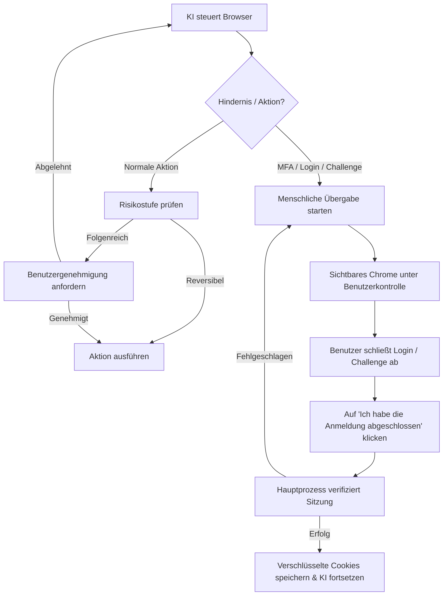

# Browser-Nutzung (Browser Use)

aiFetchly verfügt über eine integrierte **Browser-Nutzung (Browser Use)**, mit der der KI-Assistent einen sichtbaren, von Puppeteer gesteuerten Google Chrome-Browser starten und bedienen kann. Sie können dem Assistenten in Echtzeit dabei zusehen, wie er Websites durchsucht, Informationen recherchiert und mehrstufige Arbeitsabläufe automatisiert, oder jederzeit manuell die Steuerung übernehmen.


Browser Use wurde mit Fokus auf Sichtbarkeit, Privatsphäre und Sicherheit entwickelt: Sie können jede Aktion vor oder während der Ausführung überprüfen, behalten die volle Kontrolle über Ihre authentifizierten Konten und können bei Bedarf jederzeit eingreifen.

---

## Wichtigste Vorteile

- **Sichtbares Chrome-Fenster**: Startet ein echtes Chrome-Browserfenster auf Ihrem Desktop, sodass Sie genau sehen, was der Assistent sieht und tut.
- **Zwei Browsing-Modi**: Unterstützt sowohl leichtes **öffentliches Browsen** (kein Konto erforderlich) als auch **authentifiziertes Browsen** (an gespeicherte Tool-Konten gebunden).
- **Keine Offenlegung von Zugangsdaten**: Passwörter, Token und verschlüsselte Sitzungs-Cookies werden niemals an das KI-Modell, den Renderer-Prozess oder Protokolle weitergegeben.
- **Menschliche Übergabe (Human Handoff)**: Übergibt die Kontrolle nahtlos an Sie bei Multi-Faktor-Authentifizierung (MFA), Anmeldeüberprüfungen, Passkeys oder CAPTCHA-Herausforderungen.
- **Genehmigung folgenreicher Aktionen**: Erfordert Ihre ausdrückliche Bestätigung vor dem Veröffentlichen, Versenden von Nachrichten, Löschen von Daten oder Ändern von Einstellungen.
- **Isolierter Ressourcen-Cache**: Verbessert die Ladegeschwindigkeit von Seiten sitzungsübergreifend, ohne Daten zwischen Konten zu teilen oder temporäre Profile zu gefährden.

---

## Browsing-Modi

Browser Use bietet je nach Aufgabenstellung zwei unterschiedliche Modi:

### 1. Öffentliches Browsen (Temporär)

Öffentliches Browsen wird für allgemeine Recherchen, öffentliche Verzeichnisse, Nachrichtenseiten und die offene Weberkundung verwendet.

- **Kein Tool-Konto erforderlich**: Der Assistent kann jede öffentliche URL sofort öffnen.
- **Wegwerfprofil (Disposable Profile)**: Verwendet einen flüchtigen Browserkontext mit direkter Netzwerkverbindung. Nach dem Schließen der Sitzung werden keine persistenten Cookies oder Kontoprofile gespeichert.
- **Automatische Rückfallebene**: Ist für eine Domain kein Konto konfiguriert oder unterstützt, wechselt das System automatisch in den öffentlichen Modus.
- **Bedarfsgesteuerte Anmeldung**: Trifft eine öffentliche Sitzung auf eine Anmeldeschranke, wird die Steuerung im sichtbaren Browser direkt an Sie übergeben, ohne gespeicherte Tool-Konten zu verändern.

### 2. Authentifiziertes Browsen (Konto-gebunden)

Authentifiziertes Browsen verbindet den verwalteten Browser mit einem Ihrer gespeicherten **Tool-Konten (Tool Accounts)** (wie YouTube, Facebook, X/Twitter oder LinkedIn).

- **Wiederverwendung verschlüsselter Sitzungen**: Nutzt verschlüsselte Cookie-Snapshots aus dem `AccountSessionService` von aiFetchly. Cookies werden ausschließlich im Electron-Hauptprozess entschlüsselt und sicher an den Browser-Worker übertragen.
- **Exklusiver Zugriff (Exclusive Lease)**: Ein Konto kann immer nur von einer aktiven Browsersitzung gleichzeitig verwendet werden, was Konflikte und Token-Invalidierungen verhindert.
- **Automatische Aktualisierung & Speicherung**: Nach erfolgreicher Erneuerung oder ordentlicher Beendigung erfasst der Worker die aktualisierten Cookies und verschlüsselt sie erneut in der Datenbank.
- **Strikte Domain-Filterung**: Cookies werden streng nach der Whitelist der jeweiligen Plattform gefiltert, sodass sie niemals an Drittanbieter-Domains gelangen können.

---

## Browsersitzung starten

Sie können einen verwalteten Browser auf zwei Arten starten:

1. **Über AI Chat (Prompt-gesteuert)**:
   Bitten Sie den Assistenten im AI Chat:
   ```text
   Öffne mein YouTube-Konto, prüfe die Benachrichtigungen der letzten 3 Tage und fasse neue Videokommentare zusammen.
   ```
   Erfordert die Aufgabe Anmeldedaten, fordert der Assistent Sie auf, eines Ihrer kompatiblen Tool-Konten auszuwählen, bevor der Browser gestartet wird. Bei einfachen Websuchen startet er direkt im öffentlichen Modus.

2. **Über die Tool-Konten**:
   Navigieren Sie in aiFetchly zu Ihren konfigurierten Konten, suchen Sie die Zielkontokarte und klicken Sie auf **Verwalteten Browser öffnen (Open managed browser)**.

---

## Arbeitsbereich-Kopfzeile & Live-Steuerung

Während eine Browsersitzung aktiv ist, wird oben im AI-Chat-Arbeitsbereich eine dedizierte **Browser-Sitzungskopfzeile** angezeigt:

```
[● KI steuert] YouTube (Marketing Team) | Domain: youtube.com | Proxy: Aktiv (US-East) | 01:42
[ KI anhalten ]  [ Übernehmen ]  [ Browser stoppen ]
```

### Angezeigte Informationen

| Anzeige | Beschreibung |
|---|---|
| **Konto & Plattform** | Zeigt den Anzeigenamen des aktiven Kontos und die Plattform (oder „Öffentliche Sitzung“). |
| **Status-Badge** | Echtzeitstatus: *Startet (Starting)*, *Sitzung anwenden (Applying session)*, *Bereit (Ready)*, *KI steuert (AI controlling)*, *Wartet auf Genehmigung (Waiting for approval)*, *Benutzer steuert (User controlling)*, *Stoppt (Stopping)* oder *Gestoppt (Stopped)*. |
| **Bereinigte Origin** | Zeigt die aktuelle Domain (z. B. `https://youtube.com`), wobei Parameter und Abfragen zum Schutz der Privatsphäre ausgeblendet werden. |
| **Proxy-Anzeige** | Gibt an, ob ein konfigurierter Proxy aktiv ist, ohne Zugangsdaten preiszugeben. |
| **Verstrichene Zeit** | Laufzeitzähler der aktuellen Browsersitzung. |

### Steuerungsschaltflächen

- **KI anhalten (Pause AI)**: Hält automatisierte Anweisungen vorübergehend an. Der Browser bleibt auf der aktuellen Seite geöffnet, damit Sie den Zustand prüfen können.
- **Übernehmen (Take Over)**: Unterbricht die KI-Steuerung und übergibt Ihnen die Tastatur- und Mausbedienung. Nützlich zur manuellen Navigation, Lösung von Sicherheitsabfragen oder Ansicht von Details.
- **Browser stoppen (Stop Browser)**: Bricht alle laufenden Aktionen sofort ab, schließt das Chrome-Fenster, beendet den Hintergrundprozess und gibt das Konto wieder frei.

---

## Wie die KI mit Webseiten interagiert

Der Assistent bedient Webseiten über eine strukturierte und abgesicherte Tool-Architektur:

### 1. Semantische Beobachtung (`browser_observe`)

Statt rohes, unübersichtliches HTML zu verarbeiten, liest der Assistent einen **semantischen Interaktions-Snapshot**:
- Barrierefreiheitsrollen von Elementen (Schaltflächen, Textfelder, Links, Überschriften).
- Stabile interaktive Elementkennungen (z. B. `@e1`, `@e2`).
- Seitentitel, aktive URL-Herkunft und Viewport-Zustand.
- Strenges Ausblenden von Passwortfeldern, Sicherheitstoken und Autorisierungs-Headern.

:::tip Webseiteninhalte vs. Systemanweisungen
Inhalte auf externen Webseiten werden ausnahmslos als nicht vertrauenswürdige Daten behandelt. Eingebettete Prompts auf fremden Webseiten können weder die Systemanweisungen des Assistenten überschreiben noch Sicherheitsrichtlinien umgehen.
:::

### 2. Strukturierte Aktionsprogramme (`browser_run_actions`)

Der Assistent führt abgegrenzte Ketten geprüfter Aktionen aus:
- **Navigation**: URL aufrufen, zurück, vorwärts, neu laden.
- **Interaktion**: Klicken, Text eingeben, leeren, Dropdown-Optionen wählen, Tasten drücken, Hovern, Scrollen.
- **Wartebedingungen**: Warten auf Selektor, Text, Navigation oder Netzwerk-Leerlauf.
- **Extraktion**: Sichtbaren Text, Links oder bestimmte Elementattribute extrahieren.
- **Screenshots**: Sichtbare Seitenansichten aufnehmen, um den Kontext zu prüfen.

Aktionen verifizieren Elementreferenzen gegen die Revisionsnummer der Seite. Wenn sich eine Seite dynamisch ändert, beobachtet der Assistent das DOM neu, anstatt veraltete Koordinaten anzuklicken.

### 3. Privilegierte Seitenskripte (`browser_evaluate_script`)

Für komplexe DOM-Auswertungen (z. B. das Durchsuchen verschachtelter Kommentare) kann der Assistent eine benutzerdefinierte JavaScript-Funktion im Kontext der Seite ausführen.

- **Sandbox-Grenze**: Das Skript läuft ausschließlich im DOM der Webseite. Es hat **keinen Zugriff** auf Node.js, Electron-APIs, lokale Dateien, Shell-Befehle oder Betriebssystem-Ressourcen.
- **Prüfvorschau**: Vor der Ausführung wird Ihnen eine Vorschau des Skripts mit Ziel, Zeitlimit und erwarteter Ausgabe zur Genehmigung vorgelegt.
- **Lesebeschränkung**: Skripte können keine Cookie-Werte, Sitzungsschlüssel oder Passworteingaben auslesen oder zurückgeben.

---

## Menschliche Übergabe & Sicherheitskontrollen

Browser Use stellt bei kritischen Schritten stets die menschliche Kontrolle in den Vordergrund:



### Risikobasierte Aktionsgenehmigungen

Jede Browseraktion ist einer Risikostufe zugeordnet:

| Risikoklasse | Typische Aktionen | Erforderliches Verhalten |
|---|---|---|
| **Beobachten (Observe)** | Sichtbaren Text lesen, Elemente prüfen, Screenshots | Automatisch während aktiver Sitzung |
| **Reversible Interaktion (Reversible)** | Suchen, filtern, paginieren, Menüs öffnen, Entwürfe | Automatisch während aktiver Sitzung |
| **Sensible Eingabe (Sensitive Input)** | E-Mails, private Nachrichten oder Upload-Pfade eingeben | Vorschau und explizite Genehmigung erforderlich |
| **Folgenreiche Aktion (Consequential)** | Nachrichten senden, Beiträge veröffentlichen, kommentieren, folgen, Daten löschen, Käufe, Einstellungen ändern | **Explizite Bestätigung mit Ziel- und Inhaltsvorschau erforderlich** |
| **Privilegiertes Skript (Privileged Script)** | Benutzerdefiniertes DOM-JavaScript ausführen | Code-Prüfungsdialog vor Ausführung |
| **Authentifizierungsschranke (Authentication)** | Eingabe von Passwörtern, 2FA/MFA-Codes, Passkeys | **Verpflichtende Übergabe an den Benutzer** |

### Manueller Anmeldeablauf

Wenn Sitzungs-Cookies fehlen oder abgelaufen sind:
1. Der Assistent öffnet die Anmelde- bzw. Überprüfungsseite im sichtbaren Chrome-Fenster.
2. Die KI pausiert und im AI Chat erscheint der Hinweis **Anmeldung erforderlich (Login Required)**.
3. Sie melden sich direkt im Chrome-Fenster an und schließen eventuelle Sicherheitsabfragen ab.
4. Im AI Chat klicken Sie auf **Ich habe die Anmeldung abgeschlossen (I've finished logging in)**.
5. aiFetchly prüft den Anmeldestatus, verschlüsselt die neuen Cookies in Ihrem Tool-Konto und setzt die KI-Arbeit nahtlos fort.

### Umgang mit CAPTCHAs

- **Anmelde- und Sicherheits-CAPTCHAs**: Lösen immer sofort eine manuelle Übergabe aus. Externe Lösungsdienste werden hierfür niemals verwendet.
- **CAPTCHAs außerhalb sensibler Abläufe (Optionales 2Captcha)**: Ist 2Captcha in den [Systemeinstellungen](../settings/system-settings) aktiviert und die Domain autorisiert, kann ein automatischer Lösungsversuch unternommen werden. Schlägt dieser fehl, erfolgt sofort die Übergabe an Sie.

---

## Systemeinstellungen & Cache-Verwaltung

Die Einstellungen für Browser Use finden Sie unter **Einstellungen > Systemeinstellungen > Verwalteter Browser**:

| Einstellung | Standard | Beschreibung |
|---|---|---|
| **Integrierten verwalteten Browser verwenden** | Aktiviert | Aktiviert oder deaktiviert die Funktion in der gesamten Anwendung. |
| **Cache des verwalteten Browsers verwenden** | Aktiviert | Speichert statische Ressourcen pro Konto zwischen, um Ladezeiten bei wiederholten Besuchen zu minimieren. |
| **Maximaler Cache des verwalteten Browsers** | 500 MB | Obergrenze für den Festplattenspeicher der Ressourcen-Caches (Bereich: 100 MB – 2048 MB). |
| **Cache beim Schließen von aiFetchly leeren** | Deaktiviert | Bereinigt Ressourcen-Caches automatisch beim Beenden der Anwendung. |

### Cache einsehen und leeren

- **Cache des ausgewählten Kontos leeren**: Löscht zwischengespeicherte Dateien des aktuell gewählten Kontos.
- **Alle Caches des verwalteten Browsers leeren**: Bereinigt sämtliche temporären Cache-Dateien aller Konten.

:::info Cache vs. Anmeldestatus
Das Leeren des Browser-Caches **löscht niemals Ihre gespeicherten Login-Cookies oder Kontozugangsdaten**. Es entfernt lediglich temporäre Dateien wie Bilder, Skripte und Stylesheets.
:::

---

## Sicherheits- und Datenschutzprinzipien

1. **Keine Aufnahme von Geheimnissen**: Prompts und Tool-Ausgaben enthalten zu keinem Zeitpunkt Cookie-Strings, Token oder Klartext-Passwörter.
2. **Aktive Chromium-Sandbox**: Browser Use behält die standardmäßige Chromium-Sandbox und Website-Isolation bei.
3. **Native Fingerabdrücke**: Chrome verwendet User-Agent- und Plattform-Eigenschaften, die exakt zur lokalen ausführbaren Datei passen, um auffällige Fälschungen zu vermeiden.
4. **Isolierte Prozessarchitektur**: Der Browser läuft in einem separaten Electron `utilityProcess`, sodass ein Problem im Browser nicht die Hauptanwendung beeinträchtigt.
5. **Keine Modell-Codeausführung auf dem Host**: Modellgenerierter Code wird ausschließlich im DOM der Webseite ausgeführt und kann niemals Node-Module importieren oder auf lokale Systemdateien zugreifen.
