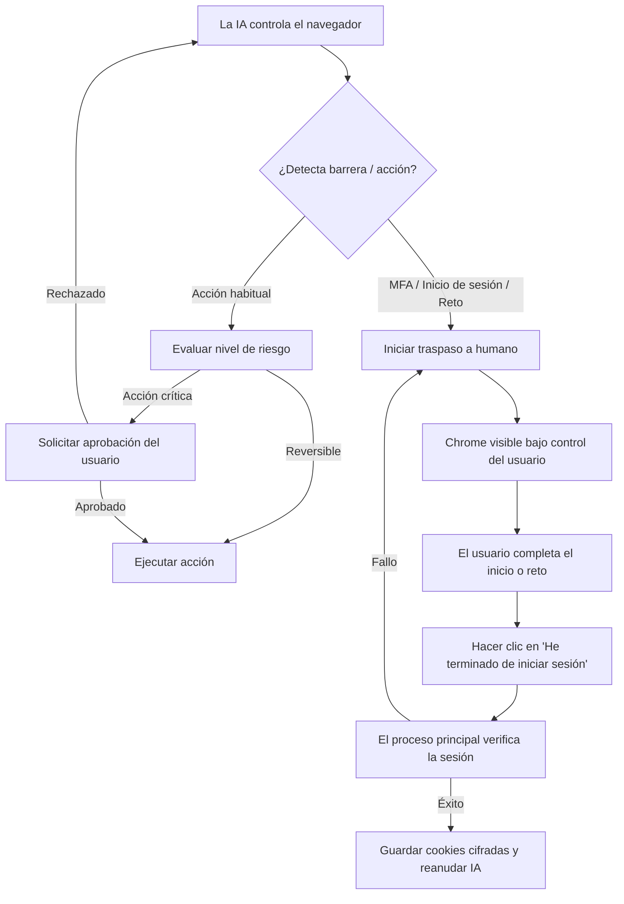

# Uso del navegador (Browser Use)

aiFetchly incluye una funcionalidad integrada de **Uso del navegador (Browser Use)** que permite al asistente de IA iniciar y controlar un navegador Google Chrome visible gestionado mediante Puppeteer. Puede observar en tiempo real cómo el asistente navega por sitios web, investiga información y automatiza tareas complejas de múltiples pasos, o tomar el control manual en cualquier momento.


Browser Use está diseñado en torno a la visibilidad, la privacidad y la seguridad: puede inspeccionar cada acción antes o durante su ejecución, mantener el control absoluto sobre sus cuentas autenticadas e intervenir siempre que sea necesario.

---

## Aspectos destacados

- **Ventana de Chrome visible**: Ejecuta una ventana real del navegador Chrome en su escritorio para que pueda ver con precisión lo que el asistente observa y realiza.
- **Dos modos de navegación**: Admite tanto la **Navegación pública** ligera (sin necesidad de cuenta) como la **Navegación autenticada** (vinculada a Cuentas de herramientas guardadas).
- **Cero exposición de credenciales**: Las contraseñas, tokens y cookies de sesión cifradas nunca se exponen al modelo de IA, al proceso de renderizado ni a los registros.
- **Traspaso a humanos (Human Handoff)**: Transfiere sin problemas el control al usuario para autenticación multifactor (MFA), verificación de inicio de sesión, passkeys o desafíos CAPTCHA.
- **Aprobaciones de acciones críticas (Consequential Actions)**: Requiere confirmación explícita del usuario antes de publicar contenidos, enviar mensajes, eliminar datos o modificar ajustes.
- **Caché de recursos aislada**: Mejora la velocidad de carga de las páginas entre sesiones sin compartir datos entre cuentas ni comprometer perfiles temporales.

---

## Modos de navegación

El uso del navegador funciona en dos modos distintos según la tarea a realizar:

### 1. Navegación pública (Efímera)

La navegación pública se utiliza para investigación general, directorios públicos, sitios de noticias y exploración abierta de la web.

- **No requiere Cuenta de herramienta**: El asistente puede abrir cualquier URL pública de inmediato.
- **Perfil desechable (Disposable Profile)**: Utiliza un contexto de navegador efímero con conexión directa. No se conservan cookies persistentes ni perfiles de cuenta tras cerrar la sesión.
- **Alternativa automática para enlaces sin cuenta**: Si no hay una cuenta configurada o compatible para un dominio, el sistema recurre automáticamente a la navegación pública.
- **Inicio de sesión bajo demanda**: Si una sesión pública encuentra una barrera de inicio de sesión, el control se entrega directamente a usted en la ventana visible sin crear ni modificar Cuentas de herramientas almacenadas.

### 2. Navegación autenticada (Vinculada a cuenta)

La navegación autenticada conecta el navegador administrado a una de sus **Cuentas de herramientas (Tool Accounts)** guardadas (como YouTube, Facebook, X/Twitter o LinkedIn).

- **Reutilización de sesión cifrada**: Reutiliza instantáneas de cookies cifradas gestionadas por `AccountSessionService` de aiFetchly. Las cookies solo se descifran en el proceso principal de Electron y se transfieren de manera segura al proceso de trabajo del navegador.
- **Arrendamiento exclusivo (Exclusive Lease)**: Solo una sesión de navegador activa puede arrendar una cuenta a la vez, lo que evita conflictos de sesión e invalidaciones de tokens concurrentes.
- **Actualización y persistencia automática**: Cuando la sesión se renueva con éxito o finaliza de forma ordenada, el proceso de trabajo captura las cookies actualizadas y las cifra nuevamente en la base de datos para futuros usos.
- **Filtrado estricto por dominio**: Las cookies se filtran rigurosamente según la lista de permitidos de la plataforma, evitando fugas hacia dominios de terceros.

---

## Iniciar una sesión de navegador

Puede iniciar un navegador administrado de dos formas:

1. **Mediante AI Chat (Indicación por prompt)**:
   Pida al asistente en AI Chat:
   ```text
   Abre mi cuenta de YouTube, revisa las notificaciones de los últimos 3 días y resume los nuevos comentarios de los videos.
   ```
   Si la solicitud requiere autenticación, el asistente le pedirá que elija una de sus Cuentas de herramientas compatibles antes de iniciar el navegador. Para búsquedas web generales, se abrirá directamente en modo de Navegación pública.

2. **A través de Cuentas de herramientas**:
   Vaya a sus cuentas configuradas en aiFetchly, busque la tarjeta de la cuenta de destino y haga clic en **Abrir navegador administrado (Open managed browser)**.

---

## Encabezado del espacio de trabajo y controles en vivo

Mientras se ejecuta una sesión de navegador, aparece un **Encabezado de sesión de navegador** dedicado en la parte superior del espacio de trabajo de AI Chat:

```
[● IA controlando] YouTube (Marketing Team) | Origen: youtube.com | Proxy: Activo (US-East) | 01:42
[ Pausar IA ]  [ Tomar control ]  [ Detener navegador ]
```

### Información mostrada

| Indicador | Descripción |
|---|---|
| **Cuenta y plataforma** | Muestra el nombre visible de la cuenta activa y la plataforma (o "Sesión pública" si no está autenticado). |
| **Insignia de estado** | Estado en tiempo real: *Iniciando (Starting)*, *Aplicando sesión (Applying session)*, *Listo (Ready)*, *IA controlando (AI controlling)*, *Esperando aprobación (Waiting for approval)*, *Usuario controlando (User controlling)*, *Deteniendo (Stopping)* o *Detenido (Stopped)*. |
| **Origen desinfectado** | Muestra el dominio actual (por ejemplo, `https://youtube.com`), ocultando consultas y parámetros para preservar la privacidad. |
| **Indicador de proxy** | Indica si hay un proxy activo configurado sin revelar sus credenciales. |
| **Tiempo transcurrido** | Cronómetro de la sesión activa del navegador. |

### Botones de control

- **Pausar IA (Pause AI)**: Detiene temporalmente las órdenes automatizadas del asistente. El navegador permanece en la página actual para que pueda inspeccionarla.
- **Tomar control (Take Over)**: Suspende el control de la IA y le entrega el control completo del teclado y el ratón. Útil para navegar manualmente, resolver pruebas de seguridad o verificar información.
- **Detener navegador (Stop Browser)**: Cancela de inmediato las acciones en curso, cierra la ventana de Chrome, finaliza el subproceso y libera el arrendamiento de la cuenta.

---

## Cómo interactúa la IA con las páginas

El asistente opera sobre las páginas web mediante una arquitectura de herramientas estructurada y segura:

### 1. Observación semántica (`browser_observe`)

En lugar de procesar HTML crudo y masivo, el asistente lee una **instantánea semántica accesible**:
- Roles de accesibilidad de los elementos (botones, cuadros de texto, enlaces, títulos).
- Marcadores de elementos interactivos estables (p. ej., `@e1`, `@e2`).
- Título de la página, origen de la URL activa y estado de la ventana gráfica.
- Eliminación estricta de campos de contraseña ocultos, tokens de seguridad y encabezados de autorización.

:::tip Contenido de página vs. Instrucciones del sistema
El contenido de las páginas web se trata estrictamente como datos no confiables. Los textos o indicaciones incrustados en sitios web externos nunca pueden invalidar las instrucciones del sistema ni eludir los controles de seguridad.
:::

### 2. Programas de acciones estructuradas (`browser_run_actions`)

El asistente ejecuta secuencias acotadas de acciones verificadas:
- **Navegación**: Ir a URL, atrás, adelante, recargar.
- **Interacción**: Clic, escribir texto, limpiar campos, seleccionar opciones de menús desplegables, pulsar teclas, pasar el cursor (hover), desplazarse (scroll).
- **Condiciones de espera**: Esperar selector, texto, navegación o inactividad de red.
- **Extracción**: Extraer texto visible, enlaces o atributos específicos de elementos.
- **Capturas de pantalla**: Tomar capturas de la página visible para verificar el contexto.

Las acciones validan las referencias de los elementos con respecto al número de revisión de la página. Si la página cambia dinámicamente, el asistente vuelve a observar el DOM antes de intentar hacer clic.

### 3. Scripts privilegiados en contexto de página (`browser_evaluate_script`)

Para extracciones DOM complejas (como recorrer cadenas de comentarios anidadas), el asistente puede generar una función JavaScript que se ejecuta en el contexto de la página.

- **Límite de aislamiento**: El script se ejecuta únicamente dentro del DOM del navegador. **No tiene acceso** a Node.js, API de Electron, archivos locales, comandos del sistema ni recursos del sistema operativo.
- **Vista previa de inspección**: Se le presenta una vista previa con el código, el propósito, el tiempo límite y la salida esperada para su aprobación previa.
- **Restricción de lectura**: Los scripts no pueden leer ni devolver valores de cookies, claves de almacenamiento de sesión ni contraseñas.

---

## Traspaso a humanos y controles de seguridad

Browser Use prioriza el control humano en situaciones críticas:



### Aprobaciones basadas en riesgo

Cada acción en el navegador pertenece a una clase de riesgo específica:

| Clase de riesgo | Acciones típicas | Comportamiento requerido |
|---|---|---|
| **Observación (Observe)** | Leer texto visible, inspeccionar elementos, capturas | Automático en sesión activa |
| **Interacción reversible (Reversible)** | Buscar, filtrar, paginar, abrir menús, redactar borradores | Automático en sesión activa |
| **Entrada sensible (Sensitive Input)** | Escribir correos, mensajes privados, rutas de subida | Vista previa y aprobación explícita |
| **Acción crítica (Consequential)** | Enviar mensajes, publicar posts, comentar, seguir, invitar, borrar datos, compras, cambiar ajustes | **Confirmación explícita requerida** con vista previa |
| **Script privilegiado (Privileged Script)** | Ejecutar JavaScript personalizado en el DOM | Cuadro de diálogo de revisión de código |
| **Autenticación (Authentication)** | Introducir contraseñas, códigos 2FA/MFA, passkeys | **Traspaso obligatorio al usuario** |

### Flujo de inicio de sesión manual

Cuando no hay cookies guardadas o han caducado:
1. El asistente abre la página de inicio de sesión o verificación en la ventana visible de Chrome.
2. La IA se pausa y en AI Chat aparece el aviso **Se requiere inicio de sesión (Login Required)**.
3. Usted inicia sesión directamente en la ventana de Chrome, completando cualquier desafío de doble factor.
4. En AI Chat, hace clic en **He terminado de iniciar sesión (I've finished logging in)**.
5. aiFetchly verifica el estado de la sesión, cifra la nueva instantánea de cookies en su Cuenta de herramienta y reanuda el trabajo de la IA sin problemas.

### Gestión de CAPTCHA

- **Retos de inicio de sesión y seguridad**: Siempre activan el traspaso manual inmediato. Nunca se envían a solucionadores externos.
- **Retos fuera de flujos sensibles (2Captcha opcional)**: Si 2Captcha está activado en [Ajustes del sistema](../settings/system-settings) y ha autorizado explícitamente el dominio, aiFetchly puede intentar una única resolución automática. Si falla o no está autorizado, pasa de inmediato al control manual.

---

## Ajustes del sistema y gestión de caché

Puede configurar Browser Use en **Ajustes > Ajustes del sistema > Navegador administrado**:

| Ajuste | Predeterminado | Descripción |
|---|---|---|
| **Usar navegador administrado integrado** | Habilitado | Activa o desactiva la función en toda la aplicación. |
| **Usar caché del navegador administrado** | Habilitado | Almacena en caché recursos estáticos por cuenta para acelerar la carga en visitas posteriores. |
| **Caché máxima del navegador administrado** | 500 MB | Límite máximo de espacio en disco asignado para caché (rango: 100 MB – 2048 MB). |
| **Borrar caché al cerrar aiFetchly** | Deshabilitado | Limpia automáticamente las cachés de recursos al salir de la aplicación. |

### Inspección y limpieza de caché

- **Borrar caché de la cuenta seleccionada**: Elimina los archivos de caché de la cuenta activa.
- **Borrar todas las cachés de navegadores administrados**: Elimina los archivos temporales de caché de todas las cuentas.

:::info Caché vs. Sesión de inicio de sesión
Limpiar la caché del navegador **nunca elimina las cookies de inicio de sesión guardadas ni las credenciales de sus Cuentas de herramientas**. Solo elimina archivos temporales como imágenes, scripts y hojas de estilo.
:::

---

## Invariantes de seguridad y privacidad

1. **Cero ingesta de secretos**: Los prompts de la IA y las observaciones de herramientas nunca contienen cadenas de cookies, tokens de autorización ni contraseñas.
2. **Aislamiento en sandbox de Chromium**: Browser Use mantiene habilitado el sandbox estándar de Chromium y el aislamiento de sitios.
3. **Huella digital nativa**: Chrome utiliza el User-Agent y las propiedades de plataforma que coinciden exactamente con el ejecutable local, evitando modificaciones aleatorias que alerten a los sistemas de seguridad.
4. **Arquitectura de proceso aislado**: El navegador se ejecuta en un `utilityProcess` independiente de Electron, evitando que un fallo en la página afecte a la aplicación principal.
5. **Sin ejecución de código del modelo en el host**: El código generado por el modelo solo se ejecuta en el DOM de la página; nunca puede iniciar procesos, importar módulos de Node ni acceder a sus archivos locales.
