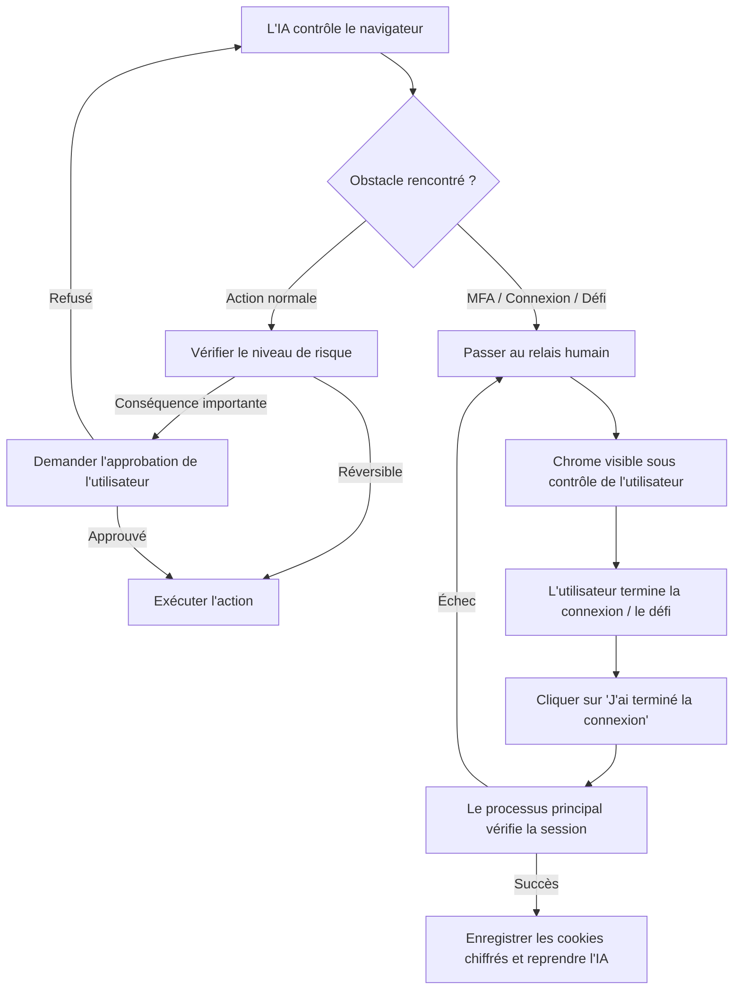

# Utilisation du navigateur (Browser Use)

aiFetchly intègre une fonctionnalité d'**Utilisation du navigateur (Browser Use)** qui permet à l'assistant IA de lancer et de piloter un navigateur Google Chrome visible géré par Puppeteer. Vous pouvez observer l'assistant naviguer sur des sites web, rechercher des informations et automatiser des tâches en plusieurs étapes, ou prendre le contrôle manuel à tout moment.


Browser Use a été conçu autour de la visibilité, de la confidentialité et de la sécurité : vous pouvez inspecter chaque action avant ou pendant son exécution, garder le contrôle total de vos comptes authentifiés et intervenir dès que nécessaire.

---

## Points clés

- **Fenêtre Chrome visible** : Lance une véritable fenêtre de navigateur Chrome sur votre bureau pour que vous puissiez voir exactement ce que l'assistant voit et fait.
- **Deux modes de navigation** : Prend en charge la **Navigation publique** légère (sans compte requis) et la **Navigation authentifiée** (associée à des comptes d'outils enregistrés).
- **Zéro fuite d'identifiants** : Les mots de passe, jetons et cookies de session chiffrés ne sont jamais transmis au modèle d'IA, au processus de rendu ou aux journaux.
- **Relais humain (Human Handoff)** : Vous transfère le contrôle en toute fluidité en cas d'authentification multifacteur (MFA), de confirmation de connexion, de passkey ou de défi CAPTCHA.
- **Approbations d'actions à conséquences** : Requiert une confirmation explicite de l'utilisateur avant de publier, d'envoyer des messages, de supprimer des données ou de modifier des paramètres.
- **Cache de ressources isolé** : Accélère les chargements de pages entre les sessions sans partager de données entre comptes ni compromettre les profils éphémères.

---

## Modes de navigation

Browser Use fonctionne selon deux modes distincts en fonction de votre tâche :

### 1. Navigation publique (Éphémère)

La navigation publique est utilisée pour les recherches générales, les annuaires publics, les sites d'actualités et l'exploration web ouverte.

- **Aucun compte d'outil requis** : L'assistant peut ouvrir immédiatement n'importe quelle URL publique.
- **Profil jetable (Disposable Profile)** : Utilise un contexte de navigateur éphémère avec mise en réseau directe. Aucun cookie persistant ni profil de compte n'est conservé après la fermeture de la session.
- **Repli automatique pour les liens non authentifiés** : Si aucun compte n'est configuré ou pris en charge pour un domaine, le système bascule automatiquement en navigation publique.
- **Connexion à la demande** : Si une session publique rencontre une page de connexion, le contrôle vous est directement transmis dans la fenêtre visible sans créer ni altérer de comptes d'outils enregistrés.

### 2. Navigation authentifiée (Liée à un compte)

La navigation authentifiée connecte le navigateur géré à l'un de vos **Comptes d'outils (Tool Accounts)** enregistrés (comme YouTube, Facebook, X/Twitter ou LinkedIn).

- **Réutilisation de session chiffrée** : Réutilise les instantanés de cookies chiffrés gérés par le service `AccountSessionService` d'aiFetchly. Les cookies sont déchiffrés uniquement dans le processus principal d'Electron et injectés de manière sécurisée dans le processus de travail du navigateur.
- **Bail exclusif (Exclusive Lease)** : Une seule session de navigateur active peut louer un compte à la fois, évitant ainsi les conflits de session et les invalidations de jetons concurrentes.
- **Actualisation et persistance automatiques** : Lorsque votre session se renouvelle ou se termine proprement, le processus de travail capture les cookies actualisés et les rechiffre dans la base de données pour les tâches ultérieures.
- **Filtrage strict par domaine** : Les cookies sont filtrés en fonction de la liste verte de la plateforme, ce qui empêche toute fuite vers des domaines tiers.

---

## Démarrer une session de navigateur

Vous pouvez démarrer un navigateur géré de deux manières :

1. **Via AI Chat (Guidé par invite)** :
   Demandez à l'assistant dans AI Chat :
   ```text
   Ouvre mon compte YouTube, vérifie les notifications des 3 derniers jours et résume les nouveaux commentaires vidéo.
   ```
   Si l'invite nécessite une authentification, l'assistant vous demandera de sélectionner l'un de vos comptes d'outils compatibles avant d'ouvrir le navigateur. Pour les recherches web générales, il s'ouvre directement en mode de navigation publique.

2. **Via les Comptes d'outils** :
   Accédez à vos comptes configurés dans aiFetchly, localisez la carte du compte cible, puis cliquez sur **Ouvrir le navigateur géré (Open managed browser)**.

---

## En-tête de l'espace de travail et commandes en direct

Lorsqu'une session de navigateur est en cours, un **En-tête de session de navigateur** dédié s'affiche en haut de l'espace de travail AI Chat :

```
[● Contrôle IA en cours] YouTube (Marketing Team) | Origine : youtube.com | Proxy : Actif (US-East) | 01:42
[ Mettre en pause ]  [ Prendre le contrôle ]  [ Arrêter le navigateur ]
```

### Informations affichées

| Indicateur | Description |
|---|---|
| **Compte et plateforme** | Affiche le nom du compte actif et la plateforme (ou "Session publique" en cas de navigation anonyme). |
| **Badge d'état** | État en temps réel : *Démarrage (Starting)*, *Application de session (Applying session)*, *Prêt (Ready)*, *Contrôle IA (AI controlling)*, *En attente d'approbation (Waiting for approval)*, *Contrôle utilisateur (User controlling)*, *Arrêt en cours (Stopping)* ou *Arrêté (Stopped)*. |
| **Origine assainie** | Affiche le domaine actuel (par ex. `https://youtube.com`), les requêtes et paramètres étant masqués pour préserver votre confidentialité. |
| **Indicateur de proxy** | Indique si un proxy configuré est actif sans révéler ses identifiants. |
| **Temps écoulé** | Chronomètre de la session de navigation en cours. |

### Boutons de commande

- **Mettre en pause (Pause AI)** : Interrompt temporairement les commandes automatisées de l'assistant. Le navigateur reste ouvert sur la page actuelle afin que vous puissiez l'examiner.
- **Prendre le contrôle (Take Over)** : Suspend le contrôle de l'IA et vous remet la main sur le clavier et la souris. Utile pour naviguer manuellement, résoudre des contrôles de sécurité ou vérifier des éléments.
- **Arrêter le navigateur (Stop Browser)** : Annule immédiatement les actions en cours, ferme la fenêtre Chrome, termine le processus de travail et libère le bail du compte.

---

## Comment l'IA interagit avec les pages

L'assistant interagit avec les pages web à travers une suite d'outils structurés et sécurisés :

### 1. Observation sémantique (`browser_observe`)

Au lieu de lire du code HTML brut et volumineux, l'assistant s'appuie sur un **instantané sémantique accessible** :
- Rôles d'accessibilité des éléments (boutons, zones de saisie, liens, titres).
- Identifiants stables pour les éléments interactifs (par ex. `@e1`, `@e2`).
- Titre de la page, domaine actif et état de la zone d'affichage (viewport).
- Exclusion stricte des champs de mot de passe masqués, des jetons de sécurité et des en-têtes d'autorisation.

:::tip Contenu de page vs Instructions système
Le contenu d'une page web est strictement traité comme une donnée non fiable. Les invites injectées sur des sites web externes ne peuvent jamais modifier les instructions système de l'assistant, ni contourner les règles de sécurité.
:::

### 2. Programmes d'actions structurées (`browser_run_actions`)

L'assistant exécute des séquences délimitées d'actions vérifiées :
- **Navigation** : Aller à l'URL, retour, avance, recharger.
- **Interaction** : Cliquer, saisir du texte, effacer, sélectionner une option, appuyer sur une touche, survoler (hover), faire défiler (scroll).
- **Conditions d'attente** : Attendre un sélecteur, un texte, une navigation ou l'inactivité réseau.
- **Extraction** : Extraire le texte visible, les liens ou les attributs spécifiques.
- **Captures d'écran** : Capturer la page visible pour vérifier le contexte.

Les actions vérifient systématiquement les références d'éléments par rapport au numéro de révision de la page. Si la page change de manière dynamique, l'assistant réobserve le DOM plutôt que de cliquer sur des coordonnées périmées.

### 3. Scripts privilégiés dans le contexte de page (`browser_evaluate_script`)

Pour les extractions DOM complexes (comme parcourir des fils de commentaires imbriqués), l'assistant peut générer une fonction JavaScript exécutée dans le contexte de la page.

- **Cloisonnement strict** : Le script s'exécute uniquement au sein du DOM de la page web. Il n'a **aucun accès** à Node.js, aux API Electron, aux fichiers locaux, aux commandes shell ou aux ressources du système d'exploitation.
- **Aperçu avant exécution** : Un aperçu vous présente le code, l'objectif, le délai d'expiration et la sortie attendue afin d'obtenir votre approbation.
- **Restrictions de lecture** : Les scripts ne peuvent pas lire ni renvoyer de valeurs de cookies, de secrets de session ou de mots de passe.

---

## Relais humain et contrôles de sécurité

Browser Use privilégie le contrôle humain pour toutes les situations critiques :



### Approbations basées sur le niveau de risque

Chaque action dans le navigateur est classée selon son niveau de risque :

| Classe de risque | Actions typiques | Comportement requis |
|---|---|---|
| **Observation (Observe)** | Lire le texte visible, inspecter les éléments, captures | Automatique lors d'une session active |
| **Interaction réversible (Reversible)** | Rechercher, filtrer, paginer, ouvrir des menus, rédiger | Automatique lors d'une session active |
| **Saisie sensible (Sensitive Input)** | Saisir des adresses e-mail, messages privés, chemins de fichiers | Aperçu et approbation explicite de l'utilisateur |
| **Action à conséquences (Consequential)** | Envoyer des messages, publier, commenter, suivre, supprimer des données, achats, modifier des paramètres | **Confirmation explicite obligatoire** avec aperçu de la cible et du contenu |
| **Script privilégié (Privileged Script)** | Exécuter du code JavaScript personnalisé dans le DOM | Boîte de dialogue d'inspection du code |
| **Étape d'authentification (Authentication)** | Saisie de mots de passe, codes 2FA/MFA, passkeys | **Relais humain obligatoire** |

### Procédure de connexion manuelle

Lorsque les cookies de session sont absents ou ont expiré :
1. L'assistant ouvre la page de connexion ou de vérification dans la fenêtre Chrome visible.
2. Le contrôle de l'IA est suspendu et une notification **Connexion requise (Login Required)** apparaît dans AI Chat.
3. Vous vous connectez directement dans la fenêtre Chrome en complétant vos éventuels contrôles de sécurité.
4. Dans AI Chat, cliquez sur **J'ai terminé la connexion (I've finished logging in)**.
5. aiFetchly vérifie l'état d'authentification, chiffre le nouvel instantané de cookies dans votre compte d'outil et reprend le flux de travail de l'IA en toute transparence.

### Gestion des CAPTCHA

- **Défis de connexion et de sécurité** : Déclenchent systématiquement un relais humain immédiat. Aucun résolveur externe n'est utilisé.
- **Défis hors flux sensibles (Option 2Captcha)** : Si 2Captcha est activé dans les [Paramètres système](../settings/system-settings) et que vous avez explicitement autorisé le domaine, aiFetchly peut tenter une résolution automatique unique. En cas d'échec ou d'absence d'autorisation, le contrôle repasse immédiatement à l'utilisateur.

---

## Paramètres système et gestion du cache

Vous pouvez personnaliser Browser Use sous **Paramètres > Paramètres système > Navigateur géré** :

| Paramètre | Par défaut | Description |
|---|---|---|
| **Utiliser le navigateur géré intégré** | Activé | Active ou désactive la fonctionnalité dans toute l'application. |
| **Utiliser le cache du navigateur géré** | Activé | Met en cache les ressources statiques par compte afin d'accélérer les visites répétées. |
| **Taille maximale du cache du navigateur géré** | 500 Mo | Définit la limite totale d'espace disque pour les caches de ressources (plage : 100 Mo à 2048 Mo). |
| **Vider le cache à la fermeture d'aiFetchly** | Désactivé | Nettoie automatiquement les caches lors de la fermeture de l'application. |

### Inspection et vidage du cache

- **Vider le cache du compte sélectionné** : Supprime les fichiers mis en cache pour le compte actif.
- **Vider tous les caches des navigateurs gérés** : Supprime tous les fichiers de cache locaux pour l'ensemble des comptes.

:::info Cache vs Session de connexion
Vider le cache du navigateur **ne supprime jamais vos cookies de connexion ni les identifiants de vos comptes d'outils**. Seuls les fichiers temporaires téléchargés (images, scripts, feuilles de style) sont supprimés.
:::

---

## Règles de sécurité et de confidentialité

1. **Aucune ingestion de secrets** : Les invites de l'IA et les observations d'outils ne contiennent jamais de chaînes de cookies, de jetons d'autorisation ou de mots de passe.
2. **Bac à sable Chromium conservé** : Browser Use conserve les protections standard du bac à sable (sandbox) et de l'isolation des sites de Chromium.
3. **Empreintes logicielles natives** : Chrome utilise les propriétés de User-Agent et de plateforme correspondant exactement à l'exécutable local, évitant ainsi les falsifications aléatoires qui déclenchent les systèmes de détection.
4. **Architecture de processus isolée** : Le navigateur s'exécute dans un `utilityProcess` Electron distinct du thread principal de l'application, garantissant une stabilité sans faille en cas de problème sur une page web.
5. **Aucune exécution de code du modèle sur l'hôte** : Le code généré par le modèle ne s'exécute que dans le DOM de la page ; il ne peut en aucun cas lancer de processus, importer des modules Node ou accéder à vos fichiers locaux.
