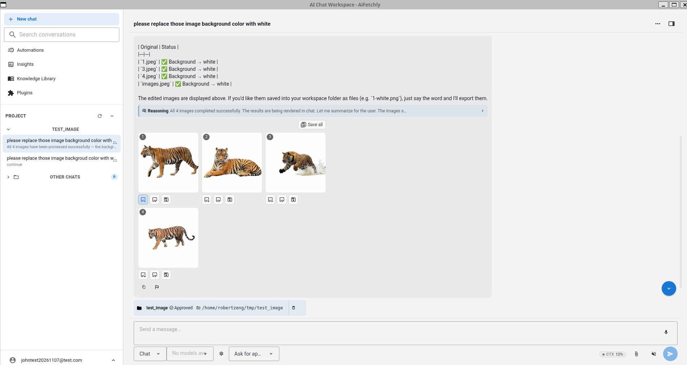

# AI Image Generation & Editing

チャットから離れずに画像を作成・調整できます。画像を依頼すると会話内に表示され、そのあと「画像に犬を追加して」のように変更を指示するだけです。チャットで生成した自分の画像を編集するのにワークスペースは**不要**です。ワークスペースが必要なのはプロジェクトのファイルや、画像をプロジェクトに保存するときだけです。

概要:

- チャットメッセージで画像を**生成**。
- 後続のメッセージで**編集**。ツールもワークスペースも不要です。
- リクエストごとに生成画像を最大 3 枚**選択・並べ替え**でき、1 枚の構図への合成にも対応。
- 多くの画像に同じ編集を**適用**するには[バッチ画像編集](./ai-image-batch-editing)（最大 50 枚）。

## 画像を生成する

コンポーザーで欲しいものを記述してメッセージを送るだけです:

- 「夕暮れのサバンナにいるライオンの画像を生成して」
- 「木のテーブルの上の白いスニーカーの商品写真を作って」
- 「子ども向けプログラミングアプリの親しみやすいロボットマスコットを描いて」

AI は通常のチャット返信のように進行状況をストリーミングします。画像が完成すると会話の中に表示されます。1 回の生成で複数の画像ができる場合は、番号付きのグリッドで表示されます。

生成された画像はアカウントと会話ごとに整理され、**あなたのマシンに保存されます**。チャットはプロバイダーの一時的なリンクに依存しないため、昨日の画像も今日も開けます。公開ギャラリーはありません。画像は生成した会話に属します。

## 生成画像を編集する

### 方法 1: ただお願いする

よくあるケースでは何も選択する必要がありません。画像を生成したあと、次のようなフォローアップを送ります:

- 「画像に犬を追加して」
- 「空を嵐にして」
- 「背景を白に置き換えて」

aiFetchly はどの画像を指しているかを**決定論的なローカルロジック**で判定します（AI モデルがパスを推測するのではありません）:

| あなたの言葉 | aiFetchly が添付するもの |
|---|---|
| 「この画像」「その画像」で、直近の生成が **1 枚**だけ | その画像 |
| 「画像 2」「2 番目の画像」 | 直近の生成でのその位置の画像 |
| 「両方」「全部」 | 直近の生成のすべての画像（最大 3 枚） |
| 明らかに **3 枚より多くの**画像へ同じ編集を適用する指示 | [バッチ画像編集](./ai-image-batch-editing)を提案 |

表現が複数の画像に当てはまる可能性がある場合、aiFetchly は推測しません。候補画像を選択ダイアログに表示し、意図した 1 枚を選んでいただきます。

:::tip 明示的な選択が常に優先

参照トレーで選択したものは自動推論より優先されます。正しい画像が使われるようにするには、自分で選択してください（次のセクション）。

:::

### 方法 2: 自分で画像を選ぶ

会話内の各生成画像にはホバー操作があります:

| 操作 | 動作 |
|---|---|
| **参照として使用** | コンポーザーの参照トレーに画像を追加します（再度クリックで解除）。 |
| **編集** | 画像を唯一の参照として追加し、指示を入力できるようコンポーザーにフォーカスします。 |
| **Open** | 画像ファイルをコンピューターで開きます。 |
| **ワークスペースに保存** | 画像をプロジェクトのワークスペースへエクスポートします。承認済みワークスペースが必要です。 |
| **すべて保存** | （複数枚の返信）その返信の全画像を一度にエクスポートします。 |

### 参照トレー

選択した画像はコンポーザー上に順序付きサムネイルで表示されます:

1. サムネイルには選択順が **1**、**2**、**3** と表示されます。
2. サムネイルの **上へ移動** / **下へ移動** で順序を変更できます。画像を合成する場合（「画像 1 を左に、画像 2 を右に」）は順序が重要です。
3. **削除** で 1 枚を外すか、**すべてクリア** でトレーを空にします。
4. 上限に達するとトレーにヒントが表示されます: 「1回のリクエストで参照できる画像は最大3枚です。」
5. トレーの内容は現在の会話に紐づき、メッセージを送るまで送信されません。

アップロード画像と生成画像の参照は同じ上限を共有します: 1 回のチャットリクエストで最大 **3 枚の画像入力**。アップロード 2 枚に参照 2 枚では 1 リクエストには多すぎます。追加の画像は次のメッセージで送るか、独立した編集ならバッチ編集を使ってください。

## 複数画像の編集と合成

参照を 2〜3 枚選ぶと次のことができます:

- **同じ変更を各画像に適用**: 「両方とも背景を白にして」。
- **複数の画像を 1 枚に合成**: 「ポスターに合成して、商品を左、ロゴを右に配置して」。

合成は**一度に 3 枚まで**です。それ以上は個別に編集するか、独立した編集には[バッチ画像編集](./ai-image-batch-editing)を使ってください。

## ワークスペース画像の編集

**プロジェクトのワークスペース**にある画像（タスクに添付したディスク上のファイル）にはワークスペースのルールが適用されます:

- ワークスペース画像の編集や分析には**承認済みワークスペース**が必要です。
- 多くのワークスペースファイルに同じ編集を適用する場合も、生成画像と同じバッチフローを使い、ワークスペース要件は維持されます。

チャット生成画像はこれらをすべて省略できます。会話のアーティファクトとして、ワークスペースなしで解決されます。ここがポイントです。編集を続けるためだけに画像をフォルダへエクスポートする必要は決してありません。

## 制限

| 制限 | 値 |
|---|---|
| チャットリクエスト 1 回の画像入力（アップロード + 参照の合計） | 3 |
| バッチジョブあたりの画像数 | 1〜50 |
| 1 リクエストで合成（組み合わせ）できる画像数 | 3 |
| 対応フォーマット | PNG、JPEG、WebP |
| 保存される生成画像のサイズ | 1 枚あたり最大約 20 MB |
| 送信画像の正規化 | 長辺最大 1568 px、目標約 1.5 MB |

送信時に過去のターンの画像が再送されることはありません。現在のメッセージで選択または明確に参照したものだけが含まれるため、画像の多い会話も速く、低コストで保たれます。

## トラブルシューティング

**「この画像参照は無効になりました。」ではなく「複数の画像が一致する可能性があります」と出た場合**
「この画像」のような表現が、複数枚を生成したターンに一致しました。選択ダイアログで意図した画像を選ぶか、参照トレーで選択してください。

**「参照できるのはこの会話で生成された画像のみです」**
参照は画像を生成した会話に限定されます。この会話で画像を生成するか、ファイルをワークスペースへコピーしてそちらで添付してください。

**「元の画像は利用できなくなりました」**
保存ファイルが失われました（ストレージ整理などで）。画像を再生成するか、別の画像を選んでください。

**「Image editing is unavailable: no edit-capable model is configured」**
ご利用の [AI プロバイダー](../settings/ai-provider)には画像編集モデルがありません。画像編集に対応したプロバイダーやモデルへ切り替えてください。

**「Unsupported image type」/「exceeds the size limit」**
生成画像は通常問題ありませんが、アップロードやエクスポートは上記の制限内で PNG、JPEG、WebP である必要があります。先に変換やリサイズを行ってください。

**画像を編集するのにワークスペースを求められる**
それは**ワークスペースのファイル**の場合だけです。チャット生成画像にワークスペースは不要です。プロジェクトのファイルを編集中なら、先にワークスペースを承認するか、生成画像をワークスペースへ保存してそこで続けてください。

## 次のステップ

- [Batch Image Editing](./ai-image-batch-editing) — 進行状況・停止・再試行付きで最大 50 枚に同じ編集を適用。
- [AI Chat V2](../ai-outreach/ai-chat-v2) — プランモードからサブエージェントまで、チャット機能の全体像。
