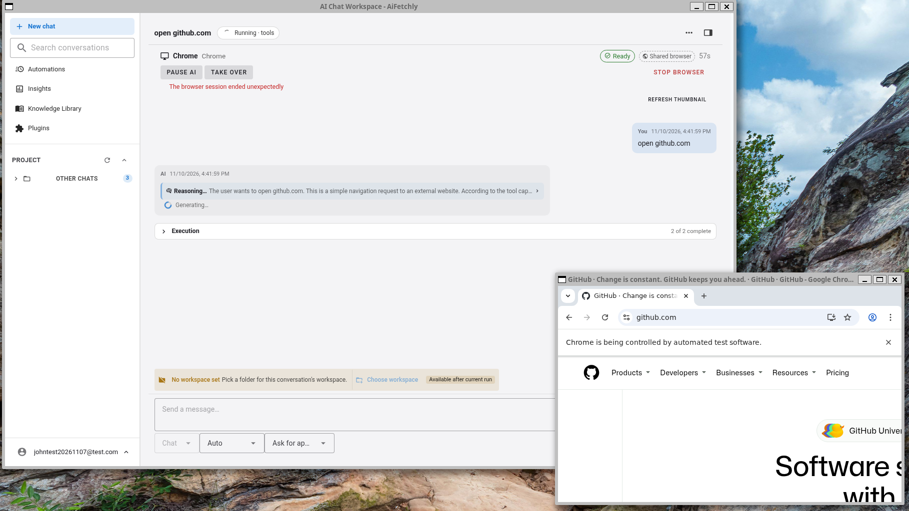
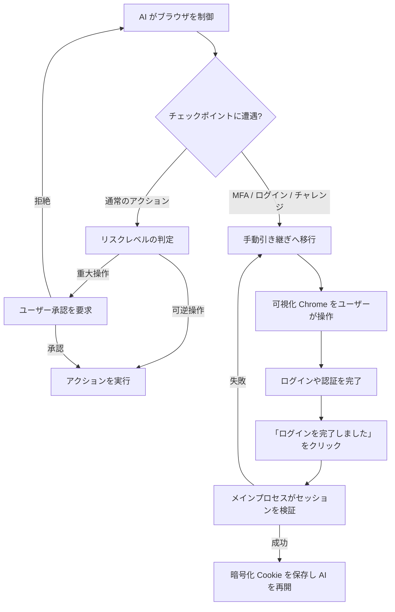

# ブラウザ操作 (Browser Use)

aiFetchly には、AI アシスタントが表示可能な Puppeteer 制御の Google Chrome ブラウザを起動・操作できる組み込みの**ブラウザ操作 (Browser Use)**機能が搭載されています。アシスタントがウェブサイトを閲覧し、情報を調査し、複数ステップのワークフローを自動化する様子をリアルタイムで確認できるほか、必要に応じていつでも手動で操作を引き継ぐことができます。



ブラウザ操作は、可視性、プライバシー、安全性を中核に据えて設計されています。実行前または実行中にすべてのアクションを確認でき、認証済みアカウントの完全な制御を保持し、必要なときにいつでも介入できます。

---

## 主な特徴

- **表示可能な実 Chrome ウィンドウ**：デスクトップ上に実際の Chrome ブラウザウィンドウを起動するため、アシスタントが見ているものと操作している内容を正確に把握できます。
- **2 つのブラウジングモード**：アカウント不要の軽量な**公開ブラウジング**と、保存済みツールアカウントに連携する**認証済みブラウジング**の双方に対応。
- **機密情報の完全保護**：パスワード、トークン、暗号化されたセッション Cookie が AI モデル、レンダラープロセス、ログに漏洩することは一切ありません。
- **人間の引き継ぎ (Human Handoff)**：多要素認証 (MFA)、ログイン確認、パスキー、CAPTCHA チャレンジの際には、スムーズにユーザーへ操作を引き継ぎます。
- **重大アクションの承認制御 (Consequential Action Approvals)**：投稿、メッセージ送信、データ削除、設定変更などの取り消せない操作の前に、ユーザーの明示的な承認を必須とします。
- **アカウント分離型リソースキャッシュ**：アカウント間でデータを共有したり一時プロファイルを侵害したりすることなく、セッション間のページ読み込み速度を向上させます。

---

## 2 つのブラウジングモード

ブラウザ操作は、タスクに応じて 2 つの異なるモードで動作します：

### 1. 公開ブラウジング (一時セッション)

公開ブラウジングは、一般的な情報リサーチ、公開ディレクトリー、ニュースサイト、オープンなウェブ閲覧に使用されます。

- **ツールアカウント不要**：アシスタントは任意の公開 URL を即座に開くことができます。
- **使い捨てプロファイル (Disposable Profile)**：ダイレクトネットワーク接続を備えた一時的なブラウザコンテキストを使用します。セッション終了後に永続 Cookie やアカウントプロファイルが保持されることはありません。
- **未認証リンクのフォールバック**：ドメインに対応するアカウントが設定されていない場合や非対応の場合は、自動的に公開ブラウジングに切り替わります。
- **オンデマンドログイン**：公開セッション中にログインが求められた場合、保存済みツールアカウントを変更することなく、表示されているブラウザ内で直接ユーザーに操作権限が渡されます。

### 2. 認証済みブラウジング (アカウント連携)

認証済みブラウジングは、マネージドブラウザを保存済みの**ツールアカウント (Tool Account)**（YouTube、Facebook、X/Twitter、LinkedIn など）に接続します。

- **暗号化セッションの再利用**：aiFetchly の `AccountSessionService` で管理される暗号化 Cookie スナップショットを再利用します。Cookie は Electron のメインプロセスでのみ復号され、隔離されたブラウザワーカープロセスに安全に注入されます。
- **排他リース (Exclusive Lease)**：同一アカウントを同時にリースできるアクティブなブラウザセッションは 1 つのみであり、セッションの競合や並行トークン失効を防ぎます。
- **自動更新と永続化**：セッションが正常に更新または終了した際、ワーカーは更新された Cookie をキャプチャし、今後のタスクのために暗号化してデータベースに再保存します。
- **厳格なドメインフィルタリング**：Cookie は各プラットフォームのホワイトリストに基づいて厳格にフィルタリングされ、第三者ドメインに漏洩することはありません。

---

## ブラウザセッションの開始方法

マネージドブラウザは、以下の 2 つの方法で開始できます：

1. **AI チャットから開始 (プロンプト駆動)**：
   AI チャットでアシスタントに依頼します：
   ```text
   私の YouTube アカウントを開いて、過去 3 日間の通知を確認し、新しい動画コメントを要約してください。
   ```
   タスクに認証が必要な場合、アシスタントはブラウザを起動する前に互換性のあるツールアカウントを選択するよう促します。一般的なウェブ検索の場合は、公開ブラウジングモードで直接開きます。

2. **ツールアカウント画面から開始**：
   aiFetchly 内のツールアカウント一覧に移動し、対象のアカウントカードで**マネージドブラウザを開く (Open managed browser)**をクリックします。

---

## AI ワークスペースヘッダーとライブ制御

ブラウザセッションの実行中は、AI チャットワークスペースの上部に専用の**ブラウザセッションヘッダー**が表示されます：

```
[● AI 制御中] YouTube (Marketing Team) | オリジン: youtube.com | プロキシ: 有効 (US-East) | 01:42
[ AI 一時停止 ]  [ 手動引き継ぎ ]  [ ブラウザ停止 ]
```

### 表示される情報

| 項目 | 説明 |
|---|---|
| **アカウントとプラットフォーム** | アクティブなアカウント名とプラットフォームを表示（未認証の場合は「公開セッション」）。 |
| **ステータスバッジ** | リアルタイム状態：*起動中 (Starting)*、*セッション適用中 (Applying session)*、*準備完了 (Ready)*、*AI 制御中 (AI controlling)*、*承認待ち (Waiting for approval)*、*ユーザー操作中 (User controlling)*、*停止中 (Stopping)*、*停止済み (Stopped)*。 |
| **サニタイズされたオリジン** | プライバシー保護のため、クエリやパラメータを除去した現在のドメイン（例：`https://youtube.com`）を表示。 |
| **プロキシ表示** | 認証情報を露出させることなく、設定されたプロキシがアクティブかどうかを表示。 |
| **経過時間** | 現在のブラウザセッションの稼働タイマー。 |

### コントロールボタン

- **AI 一時停止 (Pause AI)**：アシスタントの自動操作を一時中断します。現在のページが開いたままになるため、状態を確認できます。
- **手動引き継ぎ (Take Over)**：AI の制御を保留し、キーボードとマウスの操作権限をユーザーに切り替えます。手動での操作、セキュリティ確認の解除、画面の確認に適しています。
- **ブラウザ停止 (Stop Browser)**：進行中のアクションを即座に中止し、Chrome ウィンドウを閉じ、ワーカープロセスを終了してアカウントのリースを解放します。

---

## AI によるウェブページの操作方法

アシスタントは、信頼性と安全性を担保した多層ツールアーキテクチャを通じてウェブページを操作します：

### 1. セマンティックオブザベーション (`browser_observe`)

肥大化した生の HTML をそのまま読み込むのではなく、アクセシビリティに基づいた**セマンティックスナップショット**を取得します：
- 要素のアクセシビリティロール（ボタン、テキストボックス、リンク、見出し）。
- 安定した対話要素識別子（例：`@e1`、`@e2`）。
- ページタイトル、アクティブな URL オリジン、ビューポート状態。
- 非表示のパスワードフィールド、セキュリティトークン、Authorization ヘッダーは厳格に除外。

:::tip ページコンテンツとシステム指示の分離
ウェブページ内のコンテンツは、すべて「信頼できないデータ」として厳密に扱われます。外部サイトに埋め込まれたプロンプトインジェクションによって、アシスタントのシステム指示が上書きされたり、セキュリティガードレールが回避されたりすることはありません。
:::

### 2. 構造化アクションプログラム (`browser_run_actions`)

アシスタントは、検証された有限のアクションシーケンスを実行します：
- **ナビゲーション**：URL への移動、戻る、進む、再読み込み。
- **インタラクション**：クリック、テキスト入力、クリア、ドロップダウン選択、キー押下、ホバー、スクロール。
- **待機条件**：セレクター、テキスト、ナビゲーション、ネットワークアイドルの待機。
- **抽出**：可視テキスト、リンク、指定属性の抽出。
- **スクリーンショット**：コンテキスト確認のための表示中画面のキャプチャ。

すべてのアクションは、ページの改訂番号 (Revision) に対して要素参照を検証します。ページが動的に変化した場合、アシスタントは古い座標を無作為にクリックせず、DOM を再確認します。

### 3. ページコンテキストスクリプト (`browser_evaluate_script`)

複雑な DOM 走査（深くネストされたコメントスレッドの収集など）を行う場合、アシスタントはページコンテキスト内で実行されるカスタム JavaScript 関数を作成できます。

- **サンドボックス境界**：スクリプトはウェブページの DOM 内部でのみ実行されます。Node.js、Electron API、ローカルファイル、シェルコマンド、OS リソースへの**アクセス権は一切ありません**。
- **事前プレビュー**：実行前にスクリプトのコード、目的、タイムアウト、期待される出力が提示され、ユーザーの承認を求めます。
- **読み取り制限**：スクリプトが Cookie の値、セッションストレージの機密情報、パスワード入力値を読み取ったり返却したりすることはできません。

---

## 人間の引き継ぎと安全管理

ブラウザ操作では、重要な場面において人間のコントロールを最優先します：



### リスクベースのアクション承認

ブラウザの各操作は、以下のリスク分類にマッピングされています：

| リスク分類 | 代表的な操作 | 動作仕様 |
|---|---|---|
| **観察 (Observe)** | 可視テキストの読み取り、要素検査、画面キャプチャ | アクティブセッション内で自動実行 |
| **可逆操作 (Reversible)** | 検索、絞り込み、ページネーション、メニュー展開、下書き作成 | アクティブセッション内で自動実行 |
| **機密情報入力 (Sensitive Input)** | メールアドレス、ダイレクトメッセージ、ファイルアップロードパスの入力 | プレビューと明示的なユーザー承認が必要 |
| **重大操作 (Consequential)** | メッセージ送信、一般公開投稿、コメント、フォロー、招待、データ削除、購入、アカウント設定変更 | **対象と内容のプレビューおよび明示的な承認が必須** |
| **特権スクリプト (Privileged Script)** | カスタム DOM JavaScript の実行 | コード検査ダイアログによる承認が必要 |
| **認証ゲート (Authentication)** | パスワード入力、2段階認証 (2FA/MFA) コード、パスキー | **人間の引き継ぎが必須** |

### 手動ログインの流れ

セッション Cookie が存在しないか有効期限が切れている場合：
1. アシスタントは表示されている Chrome ウィンドウでプラットフォームの確認・ログインページを開きます。
2. AI の制御が一時停止し、AI チャットに**ログインが必要です (Login Required)**という通知が表示されます。
3. 表示された Chrome ウィンドウで直接ログインし、必要に応じて多要素認証を完了します。
4. AI チャットで**ログインを完了しました (I've finished logging in)**をクリックします。
5. aiFetchly が認証状態を確認し、更新された Cookie スナップショットを暗号化してツールアカウントに保存し、AI タスクをスムーズに再開します。

### CAPTCHA への対応

- **ログインおよびセキュリティの CAPTCHA**：常に即座に手動引き継ぎが行われます。外部の自動解決サービスが使用されることはありません。
- **非機密フローの CAPTCHA (オプションの 2Captcha)**：[システム設定](../settings/system-settings)で 2Captcha が有効化され、対象ドメインが明示的に許可されている場合、1 回のみ自動解決を試行できます。失敗した場合や未許可の場合は、直ちに手動操作に引き継がれます。

---

## システム設定とキャッシュ管理

ブラウザ操作の設定は、**設定 > システム設定 > マネージドブラウザ**でカスタマイズできます：

| 設定項目 | デフォルト | 説明 |
|---|---|---|
| **内蔵マネージドブラウザを使用** | 有効 | アプリケーション全体でのブラウザ操作機能の有効/無効を切り替えます。 |
| **マネージドブラウザキャッシュを使用** | 有効 | 静的リソース（画像、スタイルシート、スクリプト）をアカウントごとにキャッシュし、再訪時の読み込みを高速化します。 |
| **マネージドブラウザキャッシュ上限** | 500 MB | キャッシュに割り当てる最大ディスク容量（範囲：100 MB〜2048 MB）。 |
| **aiFetchly 終了時にキャッシュを消去** | 無効 | アプリケーション終了時にリソースキャッシュを自動消去します。 |

### キャッシュの確認と消去

- **選択したアカウントのキャッシュを消去**：現在選択されているツールアカウントのキャッシュファイルを削除します。
- **すべてのマネージドブラウザキャッシュを消去**：すべてのアカウントのローカルディスクキャッシュを消去します。

:::info キャッシュとログイン状態の違い
ブラウザキャッシュの消去によって、**保存されたログイン Cookie やアカウントの認証情報が削除されることはありません**。画像やスクリプトなどの一時ファイルのみが削除されます。
:::

---

## セキュリティとプライバシーの原則

1. **機密情報の完全隔離**：AI のプロンプトやツールの観測データに、Cookie 文字列、認証トークン、平文パスワードが含まれることはありません。
2. **Chromium サンドボックスの維持**：標準の Chromium サンドボックス保護およびサイト分離機能を維持した状態で動作します。
3. **ローカル環境に合致したネイティブフィンガープリント**：Chrome はローカルの実行ファイルと完全に一致する User-Agent およびプラットフォーム属性を使用し、不自然な偽装によるセキュリティ検知を防止します。
4. **独立プロセスアーキテクチャ**：ブラウザは専用の Electron `utilityProcess` で動作するため、ウェブページでクラッシュが発生してもメインアプリケーションには影響しません。
5. **ホスト上でのモデルコード非実行**：モデルが生成したコードはページの DOM 内でのみ評価され、OS 上で Node モジュールを実行したりローカルファイルにアクセスしたりすることはできません。
