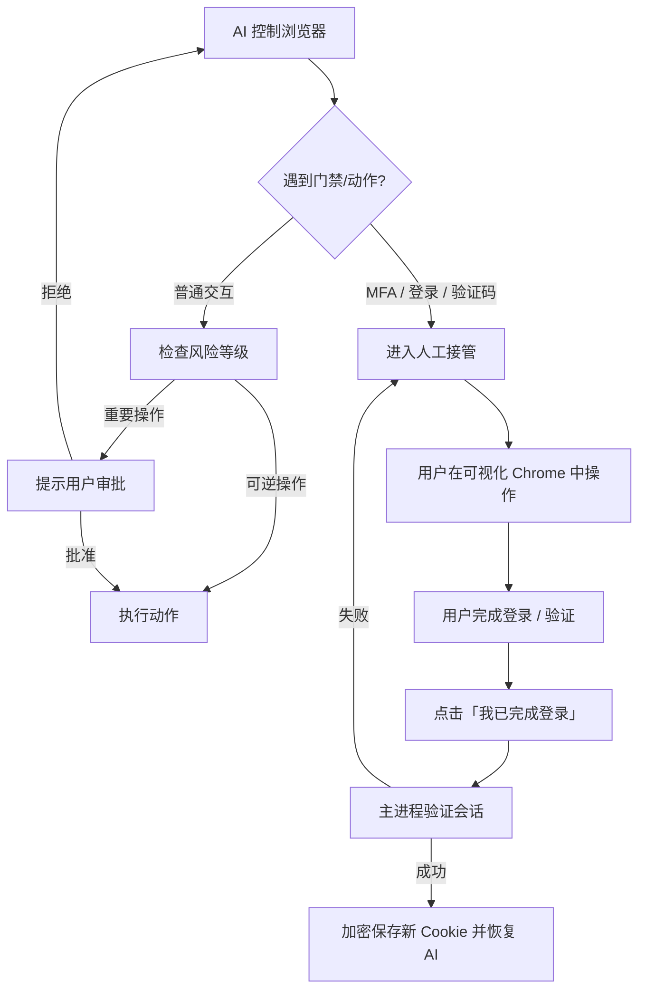

# 浏览器操作 (Browser Use)

aiFetchly 内置了强大的 **浏览器操作 (Browser Use)** 功能，允许 AI 助手启动并操控一个可视化的、受 Puppeteer 管理的 Google Chrome 浏览器。您可以实时观察助手浏览网站、调研信息与执行多步骤自动化任务，并能在需要时随时手动接管。


浏览器操作功能以可视化、隐私和安全性为核心构建：您可以在操作执行前或执行中检查每个步骤，对已认证账号保持完全控制，并能随时干预。

---

## 核心特性

- **可视化真实 Chrome 窗口**：在桌面上运行真实的 Chrome 浏览器窗口，所见即所得，清晰展示助手看到和操作的一切。
- **双浏览模式**：同时支持轻量的**公开浏览**（无需账号）与**已认证浏览**（绑定已保存的工具账号）。
- **零密码凭据泄露**：密码、Token 以及加密的会话 Cookie 绝不会暴露给 AI 模型、渲染进程或日志。
- **人工无缝接管 (Human Handoff)**：在遇到双重验证 (MFA)、登录失效、Passkey 或验证码挑战时，平滑转交控制权给用户。
- **重要操作审批 (Consequential Action Approvals)**：在发布内容、发送消息、删除数据或更改设置前，强制要求用户明确审批。
- **账号隔离的持久化缓存**：在不同会话间提升页面加载速度，同时严格隔离各账号数据，保持临时认证配置的安全性。

---

## 浏览模式

根据具体任务，浏览器操作提供两种截然不同的模式：

### 1. 公开浏览 (Public Browsing，临时会话)

公开浏览用于通用网页调研、公开黄页、资讯网站及开放网络信息检索。

- **无需工具账号**：助手可以立即打开任意公开的 URL。
- **临时环境 (Disposable Profile)**：采用无状态的临时浏览器上下文与直接网络连接。会话关闭后不会在本地保留持久 Cookie 或账号配置文件。
- **未配置账号自动降级**：如果目标域名未保存或不支持工具账号，系统会自动降级为公开浏览。
- **按需人工登录**：如果公开浏览会话遇到登录墙，控制权会直接移交给可视化浏览器中的用户，而不会修改或创建持久的工具账号。

### 2. 已认证浏览 (Authenticated Browsing，绑定账号)

已认证浏览将托管浏览器连接到您已保存的**工具账号 (Tool Account)**（如 YouTube、Facebook、X/Twitter 或 LinkedIn 等）。

- **加密会话复用**：复用由 aiFetchly `AccountSessionService` 管理的加密 Cookie 快照。Cookie 仅在 Electron 主进程中解密，并通过安全 IPC 直接注入到隔离的浏览器工作进程中。
- **独占租约 (Exclusive Lease)**：同一时间只能有一个活动会话租用同一账号，有效防止多会话并发导致的 Token 失效与冲突。
- **自动刷新与持久化**：会话成功刷新或结束关闭时，工作进程会捕获更新后的 Cookie 并重新加密保存回数据库，方便后续任务继续使用。
- **严格域名白名单**：Cookie 会根据各平台白名单进行域名过滤，绝不会泄露至第三方域名。

---

## 启动浏览器会话

您可以通过以下两种方式启动托管浏览器：

1. **通过 AI 聊天 (自然语言驱动)**：
   直接在 AI 对话中向助手发出指令，例如：
   ```text
   打开我的 YouTube 账号，检查最近 3 天的通知，并整理视频新评论。
   ```
   如果任务需要登录凭据，助手会提示您从兼容的工具账号中选择一个，然后再启动浏览器。如果是普通网页搜索，则会直接启动公开浏览模式。

2. **通过工具账号管理**：
   在 aiFetchly 的工具账号列表中，找到目标账号卡片，点击 **打开托管浏览器 (Open managed browser)**。

---

## AI 工作区状态栏与实时控制

当浏览器会话正在运行时，AI 聊天工作区的顶部会显示专门的**浏览器会话状态栏**：

```
[● AI 控制中] YouTube (Marketing Team) | 域名: youtube.com | 代理: 已启用 (US-East) | 01:42
[ 暂停 AI ]  [ 手动接管 ]  [ 停止浏览器 ]
```

### 展示信息

| 指示器 | 说明 |
|---|---|
| **账号与平台** | 显示当前活跃账号的名称与平台（若未登录则显示“公开会话”）。 |
| **状态徽章** | 实时状态：*启动中 (Starting)*、*加载会话中 (Applying session)*、*就绪 (Ready)*、*AI 控制中 (AI controlling)*、*等待审批 (Waiting for approval)*、*用户接管中 (User controlling)*、*停止中 (Stopping)* 或 *已停止 (Stopped)*。 |
| **脱敏来源 (Origin)** | 显示当前访问的域名（例如 `https://youtube.com`），自动剔除查询参数与锚点以保护隐私。 |
| **代理指示器** | 显示当前配置的代理是否生效，且不暴露代理账号与密码。 |
| **运行时长** | 显示当前浏览器会话的已运行时间。 |

### 控制按钮

- **暂停 AI (Pause AI)**：暂时中断助手的自动操作指令。浏览器保持在当前页面，以便您检查页面状态。
- **手动接管 (Take Over)**：挂起 AI 控制权，将键盘和鼠标输入交由您完全掌控。常用于手动导航、解决安全验证或查看页面内容。
- **停止浏览器 (Stop Browser)**：立即终止当前正在执行的动作，安全关闭 Chrome 窗口与后台子进程，并释放账号租约。

---

## AI 如何操控网页

助手通过严谨分层的工具体系与网页互动，兼顾灵活性与安全性：

### 1. 语义交互快照 (`browser_observe`)

助手无需解析庞大冗余的原始 HTML，而是读取**语义化交互快照**：
- 元素的无障碍角色（按钮、输入框、链接、标题等）。
- 稳定的交互元素标识符（如 `@e1`, `@e2`）。
- 页面标题、当前域名以及可视区域信息。
- 自动剔除隐藏的密码框、安全 Token 及 Authorization 请求头。

:::tip 页面内容与系统指令的区别
网页内容被严格视为不可信的数据。外部网页中嵌入的提示词（Prompt Injection）绝不会覆盖助手的系统指令，亦无法修改工具权限或绕过安全防护。
:::

### 2. 结构化动作序列 (`browser_run_actions`)

助手执行经过严格审查的有限动作链：
- **导航**：前进、后退、刷新、跳转至 URL。
- **交互**：点击、文本输入、清空输入框、选择下拉列表、按键、悬停、滚动。
- **等待条件**：等待元素出现、等待文本、等待页面导航或网络空闲。
- **数据提取**：提取可视文本、链接或指定元素属性。
- **截图**：捕获当前可视区域截图以辅助上下文校验。

所有动作均会校验页面版本号（Revision）。一旦页面发生跳转或 DOM 发生剧烈变化，助手会自动重新观察 DOM，而非盲目点击失效坐标。

### 3. 页面上下文脚本 (`browser_evaluate_script`)

面对复杂的 DOM 遍历（如深层嵌套评论树的抓取），助手可以生成受限的 JavaScript 函数并在网页上下文中执行。

- **沙箱隔离**：脚本仅在网页 DOM 内部执行，**绝无权限**访问 Node.js、Electron API、本地文件、Shell 命令或操作系统资源。
- **安全预览**：在执行前，系统会向您展示脚本源码、执行意图、超时时间与预期输出供您审批。
- **读取限制**：脚本无法读取或返回 Cookie、SessionStorage 密钥或密码输入值。

---

## 人工接管与安全控制

浏览器操作在关键场景下严格以人类控制为优先：



### 基于风险等级的操作审批

浏览器的每一项操作均映射到相应的风险级别：

| 风险级别 | 典型操作 | 系统行为 |
|---|---|---|
| **观察 (Observe)** | 读取可视文本、检查元素、页面截图 | 在活动会话内自动执行 |
| **可逆交互 (Reversible)** | 搜索、筛选、翻页、展开菜单、起草文本 | 在活动会话内自动执行 |
| **敏感输入 (Sensitive Input)** | 填写邮箱、私信、选择上传文件路径 | 弹出预览并需用户明确确认 |
| **重要操作 (Consequential)** | 发送消息、公开发帖、发表评论、关注、邀请、删除数据、购买、修改账号设置 | **必须弹出预览并获得明确批准** |
| **页面脚本 (Privileged Script)** | 执行自定义 DOM JavaScript 脚本 | 弹出代码审查对话框经批准后运行 |
| **身份认证门禁 (Authentication)** | 输入密码、双重验证码 (2FA/MFA)、Passkey | **强制转交人工接管** |

### 手动登录与验证流程

当保存的会话 Cookie 缺失或已过期失效时：
1. 助手在可视化的 Chrome 窗口中自动打开平台的登录或验证页面。
2. AI 操作自动挂起，AI 聊天区显示 **需要登录 (Login Required)** 通知。
3. 您在可视化的 Chrome 窗口中直接输入凭据，完成 MFA 或安全验证。
4. 登录完成后，在 AI 聊天区点击 **我已完成登录 (I've finished logging in)**。
5. aiFetchly 自动验证登录态，将刷新后的 Cookie 加密存入工具账号，并平滑恢复 AI 任务。

### 验证码 (CAPTCHA) 决策策略

- **登录与账号安全验证码**：一律强制由人工在浏览器中完成，绝不会发送给任何第三方打码服务。
- **非登录普通验证码 (可选 2Captcha)**：若在[系统设置](../settings/system-settings)中启用了 2Captcha 且您明确授权了该域名，系统可尝试发起单次自动化识别。若失败或未授权，将立即转入人工接管模式。

---

## 系统设置与缓存管理

您可以在 **设置 > 系统设置 > 托管浏览器** 中调整配置：

| 设置项 | 默认值 | 说明 |
|---|---|---|
| **使用内置托管浏览器** | 已启用 | 全局控制是否允许 AI 启动托管浏览器。 |
| **使用托管浏览器缓存** | 已启用 | 按账号隔离复用静态资源（图片、样式表、JS），显著提高重复打开页面的加载速度。 |
| **托管浏览器缓存上限** | 500 MB | 限制磁盘缓存占用的最大空间（可选范围：100 MB – 2048 MB）。 |
| **aiFetchly 关闭时清理缓存** | 已禁用 | 在退出应用程序时自动清理托管浏览器的临时资源缓存。 |

### 检查与清理缓存

- **清理选中账号缓存**：仅删除当前选定工具账号的缓存文件。
- **清理全部托管浏览器缓存**：清除本地磁盘上所有账号的托管浏览器缓存。

:::info 缓存与登录状态的区别
清理浏览器缓存**绝不会删除已保存的登录 Cookie 或账号凭据**，它仅清除本地临时下载的图片、脚本与样式文件。
:::

---

## 安全与隐私底线

1. **零密钥吞吐**：AI 提示词与工具观察结果中绝不包含任何 Cookie 字符串、认证 Token 或明文密码。
2. **保留 Chromium 沙箱**：始终启用 Chromium 原生沙箱保护与站点隔离机制。
3. **原生可执行文件指纹**：Chrome 使用与本地可执行文件完全一致的原生 User-Agent 与运行环境属性，坚决杜绝因伪造冲突特征引发的风控拦截。
4. **独立进程架构**：浏览器由专属的 Electron `utilityProcess` 独立管理，与主应用渲染界面隔离，页面崩溃绝不影响主程序运行。
5. **宿主机零任意代码执行**：模型生成的代码仅限于网页 DOM 上下文，绝对无法在操作系统中执行 Node 模块或访问系统文件。
